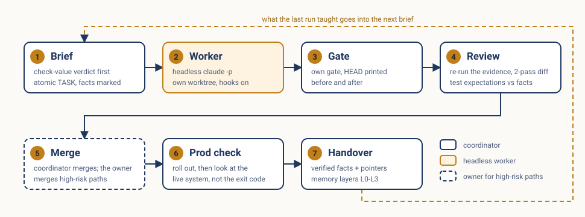

# agent-ops

An operating kit for one pattern: **a coordinator agent that briefs a headless worker, and
refuses to believe the worker's report until it has re-run it.**

It is extracted from the way the product at <https://nab.rs> is built: a Claude Code
session (the *coordinator*) writes atomic task briefs for `claude -p` runs (the *workers*);
each worker works in its own git worktree under hooks, and must hand back a pushed branch and
a draft PR. The coordinator reviews, approves an exact commit, and a merge train gates the
approved PRs together, so that `main` is always a tree that was tested as a whole. The owner
decides about money and about anything irreversible.

This is working tooling, not a framework. Everything here is a shell script, a hook or a
markdown file you can read in a few minutes.

<picture>
  <source media="(prefers-color-scheme: dark)" srcset="assets/loop-dark.svg">
  
</picture>

## What is in the box

| Path | What it is |
|---|---|
| `bin/run_worker.sh` | One-command launcher: validates the brief, makes a worktree, pushes the brief, starts `claude -p` detached with the API key unset, checks liveness. `DRY=1` validates only. |
| `hooks/guard_bash.py` | PreToolUse guard: blocks merge, "ready", non-draft PRs, pushes to protected branches, force-push, a test run piped into a commit, and commits that skip hooks with the no-verify flag. |
| `hooks/stop_gate.py` | Stop hook: the run cannot end until the tree is clean, the gate passes on HEAD, HEAD is pushed and a draft PR exists. |
| `hooks/settings.example.json` | How to wire both into Claude Code settings. |
| `prompts/BRIEF_PREAMBLE.md` | Rules every worker run starts with (hard-limit mode, evidence document with empty-implementation checks, quick check on a merge with fresh main, no questions, search for existing code first, probes against shared systems, exit after the PR, one kind of change per PR). |
| `prompts/TASK_TEMPLATE.md` | The shape of one brief. |
| `skills/check-value` | Decide whether a task is real before briefing; verdict in words and numbers. |
| `skills/launch-worker` | Brief, launch, watch and stop a worker; fix runs on the PR's own branch; a run without a start line did not start. |
| `skills/accept-worker-pr` | Accept a worker's PR: re-run evidence, wider tests than the worker ran, three independent reviewers (brief, previous behaviour, standards), approve the exact commit. |
| `skills/merge-deploy` | Who may merge what, approval pinned to a commit, the merge train, backups before migrations, how to confirm a release. |
| `skills/verify-traps` | Specific ways a check lies: accounts, aggregates, flags, tautological assertions, tests red only in the gate. |
| `skills/version-check` | Decide whether to update the tooling now. |
| `docs/ARCHITECTURE.md` | The map and the invariants. |
| `docs/COORDINATOR_LOOP.md` | Essay: how a coordinator ships code with a headless worker. |
| `docs/VERIFYING_AI_PRS.md` | Essay: how to verify a PR written by an AI. |
| `docs/MEMORY_LAYERS.md` | When an observation may become a rule. |
| `docs/MERGE_TRAIN.md` | How approved PRs are merged in batches with one gate, so that `main` equals the tested tree. |
| `docs/COORDINATOR_SESSION.md` | Hooks that guard the coordinator itself: facts at session start, context guard, handover while gates run. |
| `docs/SHARED_MACHINE.md` | Several agents on one small machine: FIFO gate lock, slot limit, janitor, flaky tests with reasons. |
| `assets/` | The loop and the merge train as SVG, light and dark. |
| `tests/` | Tests for the hooks and the launcher; no network. |

## In numbers

As of November 2026, for the project this was extracted from:

- 1,100+ merged pull requests and 2,500+ commits since 2 May 2026
- 100+ of those merged through the merge train in its first two weeks
- 70,000+ tenders processed; 25,000+ notifications delivered (as of October 2026)
- 18 live data sources
- 13,900+ tests passing in the gate
- 34+ architecture decision records

These describe the product the loop built, not the loop. They are here so you can judge
whether the process survives contact with a real codebase.

## What went wrong

The rules in this repository are scars. Each is a real incident, reduced to its lesson.

1. **A report said "GATE PASS" and an unformatted test was in the PR.** The gate had run
   before the last commit. Now the gate runs after the final commit, the coordinator re-runs
   it, and the stop hook stamps PASS per HEAD.
2. **A gate "passed" about someone else's commit.** A periodic reset in a shared clone moved
   the branch between checkout and test. Now every gate runs in its own worktree and prints
   the HEAD before and after.
3. **A commit landed on top of red tests.** `pytest | tail && git commit` took its exit code
   from `tail`. Test runs are never piped before a commit.
4. **A worker ran its gate in the background and exited.** A headless run kills what it left
   running; no PR was opened. The preamble demands a foreground gate and the stop hook demands
   a PR.
5. **A non-draft PR was auto-merged before anyone looked.** PRs are draft-only, enforced by
   the guard, not requested by a prompt.
6. **An empty "open PRs" list was read as "no PR".** Auto-merge had already merged it, and a
   duplicate was opened. Lookups use `--state all`.
7. **Green tests that asserted nothing.** An expectation computed from the same catalogue as
   the code; a mock test named after a check the mock never ran. Expectations are now literals
   taken from a real run, and a mutation must be shown to have applied.
8. **Phantom tasks.** Six queued tasks were removed in one day by fact: the supposed defect was
   in zero rows, or not in the source, or already handled. A verdict step now comes before
   every brief, and a removed phantom is written down with its numbers.
9. **Two green branches, one red main.** One PR raised a cap from 12 to 30; a parallel PR
   mirrored the old 12 in a page and its test. Neither branch could see the conflict. Before
   merging, the old value is searched for across the neighbouring branches, and the merged
   main gets one more gate run.
10. **The gate became the bottleneck.** With several workers, every PR went through the full
    gate three or four times, and gates queued for hours behind one lock. Now workers run a quick
    check, the coordinator approves a commit, and one gate runs on a batch of merged PRs
    (`docs/MERGE_TRAIN.md`).
11. **A batch merged only its first PR, again and again.** The train squashed each PR; the
    trees matched but the history did not, and a generated file carrying a commit hash
    conflicted on the second PR. 54 train stops in eleven days. Merge commits fixed it by
    construction, and the train now compares the tree of `main` with the tested tree.
12. **The gate lock was not a queue.** A bare `flock` lets newcomers overtake; one gate waited about
    four hours, and "could not get the lock" looked like a red gate. The lock became a FIFO of
    tickets, and lock or memory failures are retried instead of being blamed on a PR.
13. **An innocent PR was blamed four times.** A signal test was red only in background gates,
    because a background process inherits SIGINT as ignored. Reproductions under `timeout`
    looked green. Tests that are red only in the gate are now reproduced in the gate's
    environment, and the same test failing for different PRs counts as a defect of `main`.
14. **Six fixes for the wrong cause.** A database test was red only in the full parallel run.
    The cause was a neighbour on the same parallel worker that leaked a dependency override.
    Replaying the gate's per-worker order and bisecting the file list found it in 15 minutes.
15. **A brief was followed to the letter and something that worked broke.** A search for the
    number of an expired record stopped opening its card. Review now has a separate reader
    for "what did the user get before this PR and after", next to the brief and the standards.
16. **Three of nine review blockers were invisible in the branch.** They came from a change
    merged into `main` after the branch point. Reviewers now get the log from the merge base
    to `main` and are asked to check for overlap in meaning.
17. **"Quick pass" with fifteen red tests.** The worker's quick check picked tests by file name;
    render tests never name the template they cover. Selection now also uses a coverage map,
    and a template change runs the whole render-test directory. The train's full gate stays
    the proof.
18. **A fix run made duplicate PRs.** Launched under a new name, it made its own branch, and its
    stop hook demanded a PR from that branch. A fix now runs on the PR's own branch.

## Limitations

- **Not the product.** The service this was extracted from, its production scripts and its
  rollout procedure are not here.
- **The quick check is not shipped.** The stop hook runs `AGENT_OPS_GATE_CMD` (default: the
  full gate); point it at your own fast check if you have one.
- **The merge train is described, not shipped.** Its scripts are tied to one host; the design,
  the decisions and the incidents behind them are in `docs/MERGE_TRAIN.md`.
- **No supervisor.** There is no scheduler, no run database, no automatic relaunch. A
  supervisor that launches paid runs by itself would break the rule that spend needs a human
  word, so launching stays a command someone types.
- **The guard is a regex, not a sandbox.** It catches honest mistakes. It does not stop a worker
  that deliberately builds a command around it. Run workers under a low-privilege account with
  a token that cannot merge.
- **Runs with permission prompts disabled.** The launcher starts workers with
  `--dangerously-skip-permissions`, because a headless run cannot answer a prompt. The hooks
  and the account's limits are then the only barrier.
- **Claude Code 2.1 or newer** is assumed for the hook interface (`PreToolUse` exit code 2,
  `Stop` with `decision: block`). Check your version's documentation: <https://docs.anthropic.com>.
- **Defaults come from one setup.** Branch prefix, gate command and model name are
  configurable; the rest assumes a git host with the `gh` CLI, and a gate that is a single
  command.

## Quick start

1. Clone or copy this directory, for example to `~/agent-ops`.
2. Merge `hooks/settings.example.json` into the worker account's Claude Code `settings.json`
   (`~/.claude/settings.json`), fixing the paths to where you put the hooks.
3. Set the hooks' environment if your names differ:
   `AGENT_OPS_BRANCH_PREFIX` (default `worker/`), `AGENT_OPS_GATE_CMD`
   (default `bash scripts/gate.sh`; point it at a quick check if a merge train runs the full
   gate), `AGENT_OPS_PROTECTED` (default `main,master`).
4. Write a brief from `prompts/TASK_TEMPLATE.md` that mentions `BRIEF_PREAMBLE`, and keep
   `prompts/BRIEF_PREAMBLE.md` reachable by the worker (copy it into your repository).
5. Check the launcher without side effects:
   `DRY=1 bin/run_worker.sh my-task cheap path/to/brief.md`
6. Launch for real by dropping `DRY`. Anything other than the cheap default model needs
   `ALLOW_EXPENSIVE=1`, which is meant to be set only after the owner has agreed to the spend.
7. Copy `skills/*` into your coordinator's `.claude/skills/` and use them when you check an
   idea and when you accept a PR.

Run the tests: `python3 -m pytest -q tests`.

## Reading order

`docs/COORDINATOR_LOOP.md` for the story, `docs/ARCHITECTURE.md` for the map and the
invariants, `docs/VERIFYING_AI_PRS.md` if you review AI-written code, `docs/MERGE_TRAIN.md`
when more than one worker opens PRs, `docs/SHARED_MACHINE.md` if they share a host, and
`docs/MEMORY_LAYERS.md` and `docs/COORDINATOR_SESSION.md` if your agents keep notes between
sessions.

## License

MIT. See `LICENSE`. Source: <https://github.com/TnSrb1/agent-ops>.
