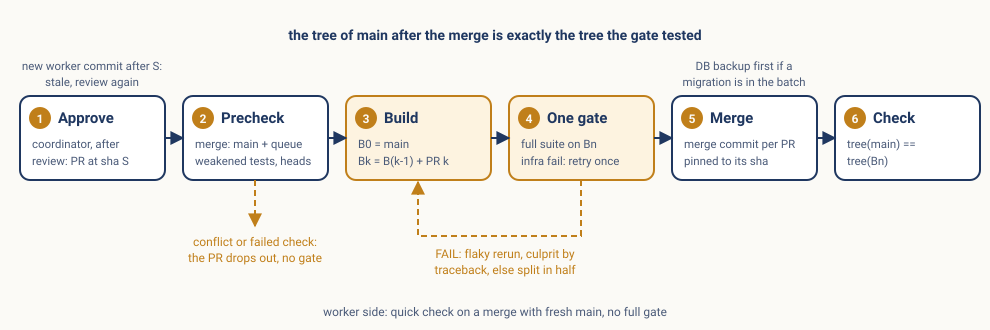

# The merge train: one gate for a batch of AI-written PRs

The coordinator loop in `COORDINATOR_LOOP.md` accepts one PR at a time: review, own gate, merge.
That holds while a worker opens a PR or two a day. It stopped holding when several workers ran
in parallel on one small machine. The full gate took 15 to 45 minutes under load, a PR went
through it three or four times (worker, coordinator, after a rebase, after the merge), and the
gates queued behind one lock. Throughput was capped by the serial gate, not by the speed of the
tests.

The merge train is the answer that has been running since mid-November 2026. More than a
hundred PRs went through it in its first two weeks. Its contract is one sentence:

> **The tree of `main` after the merge is exactly the tree the gate tested.**

<picture>
  <source media="(prefers-color-scheme: dark)" srcset="../assets/train-dark.svg">
  
</picture>

## Who does what

| Role | Before the train | With the train |
|---|---|---|
| Worker | full gate before push (holds the lock 20+ minutes) | a quick check on the merge with fresh `main` (2-5 minutes, no lock) |
| Coordinator | review, own gate, merge, gate again on `main` | review, then **approve one commit**; nothing else |
| Dispatcher | did not exist | precheck, batch, one gate, bisect, merge |
| Owner | merges high-risk paths | unchanged: the train refuses to merge a migration without a fresh backup |

The review does not move into the train. A green gate is not acceptance: several defects that
reached review had a green gate (a fix that bypassed a mode, a search that stopped finding
expired records). The train only replaces the *repeated* gates.

## Step by step

```
 coordinator: approve PR N at commit S
        |
        v
 dispatcher (every 2 min, waits a few minutes to collect a batch, at most 5 PRs)
        |
        |-- branch moved past S with the worker's own commits?  -> "stale": needs a new review
        |
        v
 precheck, per PR, cheap (no test database, no full suite):
   merge-main   : does it merge into the current main?          (conflict -> drops out)
   merge-queue  : does it merge with the PRs already accepted?  (conflict -> drops out)
   test-weaken  : were existing tests weakened without a declared section?
   filenames    : is every basename short enough for the deploy target?
   one head     : one migration head on the merged tree?
   type ratchet : did the type-checker debt grow?
        |
        v
 build: B0 = main, Bk = B(k-1) merged with PR k   (generated files are regenerated, not merged)
        |
        v
 ONE full gate on Bn  --- infrastructure failure (lock, out of memory)?  -> retry once
        |
   PASS |                       FAIL (tests)
        |                          |
        |                    triage: known flaky test green on rerun?  -> PASS
        |                            every failure traces into ONE PR's files? -> that PR drops out
        |                            otherwise -> split the batch in half, recurse
        v
 backup the database if any PR touches migrations (no backup, no merge)
        |
        v
 for k = 1..n: push Bk to PR k's branch (fast-forward only), merge PR k with a MERGE commit,
               pinned to that commit (`--match-head-commit`)
        |
        v
 compare: tree(main) == tree(Bn)?   -> "main = the tested tree", alert to the chat
```

## Design decisions, and the incident behind each

**Approval is pinned to a commit, not to a PR.** The coordinator approves "PR N at sha S". If the
worker pushes again after that, the approval becomes stale and the PR waits for a new review.
Commits added by the train itself (the merge of earlier batch members) do not invalidate it.
*Why:* a live fix worker kept pushing report-only commits after review; any gate on the old
sha would have merged something nobody had read, or refused forever.

**The gate runs on the merged batch, not on each branch.** Two branches green on their own
make a red `main` when one changes behaviour the other pinned with an assertion. Neither branch
can see that; the merged tree can. A gate on `Bn` tests what will actually ship.

**Precheck before the gate.** A full gate costs 15+ minutes; a merge conflict or a weakened test
is found in seconds. The test-weakening guard alone accounted for 4 of the first 52 train
failures, each of which had burned a whole gate. Cheap checks now run first, and a precheck that breaks as a tool does not stop the train: it is skipped
and logged, because a broken checker is not a broken PR.

**Infrastructure failure is not a red test.** "Could not get the gate lock", a killed worker
process or an out-of-memory kill look like FAIL in a log. The gate log is grepped for these
markers first; such a run is retried once and then postponed, and no PR is blamed for it.

**Bisect, but try to name the culprit first.** A failed batch is split in half and each half is
gated again. That costs a gate per level, so before splitting, the train reads the failing
tracebacks: if every non-flaky failure touches files of exactly one PR, that PR drops out and
the rest are gated without it. A short list of known flaky tests is allowed one green rerun;
the list is curated by hand and each entry names its cause.

**Merge commits, not squash.** The first version squashed each PR. The trees matched, but the
history did not: PR k+1's branch is a descendant of `Bk`, and after a squash `main` no longer
contains `Bk` as a commit. A generated file whose header carries a commit hash then conflicted
on the second PR of a batch: 54 train stops in eleven days, and 48 of 78 batches ended up
merging a single PR. With a merge commit `Mk` whose tree is `Bk`, PR k+1 merges cleanly by
construction.

**The final check compares trees, not statuses.** After the last merge the train compares the
tree hash of `main` with the tree hash of `Bn`. Equal means the shipped code is the tested code.
Unequal means a partial merge (a later PR was refused) and is reported, never silently accepted.

**Stale "conflicting" status is re-checked.** Right after a neighbour's merge the hosting service
can report a PR as conflicting for a few minutes while a trial merge is clean. The merge step
waits and re-reads the status before giving up; a lost merge costs a 20-minute gate.

**A dropped PR stays dropped until it is approved again.** A PR that dropped out on a conflict
was once picked up again every two minutes: 178 starts and an alert storm. A drop is now a
state file newer than the approval, and only a fresh approval clears it.

## Dispatcher details

Checked against the running dispatcher on 26 November 2026:

- **When a batch starts.** The dispatcher polls every two minutes. It starts a train when the
  newest approval is at least `BATCH_WAIT` old (default 300 s), or as soon as three approved PRs
  are waiting. It takes the five lowest numbers. Waiting collects a batch; three PRs is enough
  not to wait longer.
- **Stale means "the worker moved".** After approval, only commits by the coordinator and merge
  commits are allowed on top of approved commit S. Any other commit from the worker, or a
  rewritten branch where S is no longer an ancestor, renames the approval to `stale` and the PR
  waits for a new review.
- **A closed PR loses its approval.** If a PR is no longer open when polled, the approval is
  deleted, so a merged or closed PR cannot be rebuilt into a batch.
- **One dispatcher, one train.** Each takes a non-blocking lock at start and exits if it is
  already running. A `STOP` file next to the state directory ends the dispatcher cleanly at the
  top of its next loop; a train in progress is not interrupted.
- **A broken precheck is skipped, not blamed.** If the precheck itself exits with an unexpected
  code, the PR stays in the batch and the full gate decides.

## The worker side: a quick check instead of the gate

The worker no longer runs the full gate. Its stop hook requires a **quick check** on the
current HEAD:

1. If the branch is behind `main`, the check runs on a temporary merge with fresh `main`
   (a branch green alone can be red together with `main`). A conflict outside docs fails it.
2. Linter and formatter on the changed files.
3. The same precheck the dispatcher runs (test-weakening guard, file names, migration heads,
   type ratchet).
4. Tests selected by the change: tests that name the changed module, tests found through a
   **coverage map** (which tests execute this file, even without importing it by name), a whole
   test directory when a template or a translation catalogue changed (render tests rarely
   name the template file), the database tests that cover the change on a throwaway database,
   and a fixed set of cheap quality guards.

*Why the coverage map:* selection by file name missed most covering tests. Four of nine PRs
approved on targeted tests were red on the full suite; one passed "QUICK PASS, 1,838 passed"
with fifteen red render tests that never mentioned the template it changed. The quick check is
still a filter, not a proof: the train's full gate is the proof.

## What the coordinator still does by hand

- The review, on three independent axes (see `skills/accept-worker-pr`).
- Deciding about high-risk paths and anything irreversible, with the owner.
- Reading the train log after each batch: "main = the tested tree", or why not.
- Not pushing to `main` while a train is running: a push moves the base under the gate, the
  train sees "main moved" and rebuilds, and a long run never finishes.

## Limits

- The train serialises merges. It does not make the gate faster; it makes it run once.
- A batch of five is a compromise between the cost of a bisect level and the cost of a gate.
- Triage by traceback is a heuristic. When it is unsure, it falls back to splitting.
- The scripts are tied to one host and are not in this repository; the design is.
