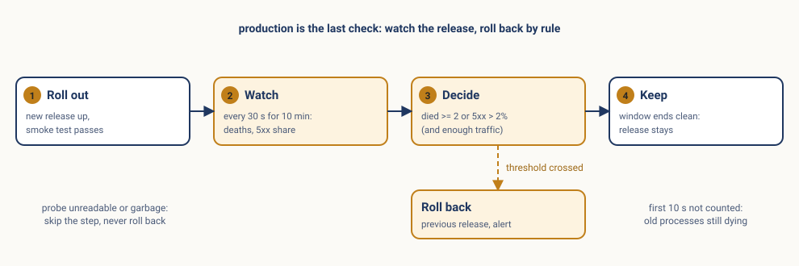

# Roll-out and roll-back: production as the last check

A green gate says the code passed the tests. It does not say the release is healthy. Some
failures only exist in production, and they do not show up at the moment of the smoke test:
a process supervisor kills a "hung" worker two minutes after the start, a proxy returns
502 in the middle of a request, a cold start under load takes longer than a health
timeout. A smoke test looks at one point in time; these look like a short, bad window.

So the roll-out does not end when the new version answers. It ends when the version has been
watched for a fixed window and nothing crossed a threshold.

<picture>
  <source media="(prefers-color-scheme: dark)" srcset="../assets/watch-dark.svg">
  
</picture>

## The rule

After every roll-out, for `WINDOW` seconds (default 600), poll every `INTERVAL` seconds (30)
and count since the start of the window, minus a short grace period (10 s) in which the
old processes are still dying:

| Signal | Source | Roll back when |
|---|---|---|
| processes killed by the supervisor | the application log ("child process died") | 2 or more |
| server errors | the proxy's access log, status 500 and above | more than 2 % of responses, and at least 20 responses |
| event-loop stalls | the watchdog in `OBSERVABILITY.md` | **reported only**, never a reason |

Three details carry most of the value:

1. **The percentage is strictly "more than", and has a floor of traffic.** Two errors out of
   three responses at night are not an incident; 2 % of 20 responses is. Without the floor
   a quiet hour rolls back healthy releases.
2. **An unreadable probe is not a reason to roll back.** If the log cannot be read, the
   measuring tool is broken, not the release. The step is logged and skipped. A rollback
   caused by a broken probe is a second outage that you scheduled yourself.
3. **Signals that are only informative stay informative.** Stalls are counted against a
   baseline taken from the same window *before* the roll-out (from the old container's log),
   so the notification says "stalls 3, baseline 2", not an unexplained "3".

## The tool

`bin/watch_release.py` is the loop, generic and dependency-free. You supply two commands:

```bash
python3 bin/watch_release.py \
  --probe    './my_probe.sh'    \   # prints {"died": N, "bad": N, "total": N} since $WATCH_SINCE
  --rollback './my_rollback.sh' \   # puts the previous release back
  --window 600 --interval 30 --grace 10 \
  --died-max 2 --bad-pct 2 --bad-min 20
```

Exit code `0` healthy, `3` rolled back, `4` the rollback command itself failed (page a
human), `2` bad usage. It prints one JSON line with the reason, for your chat notification.

The decision is a pure function (`evaluate`) and the loop takes an injected clock, so the
tests run in milliseconds: thresholds at their exact edges, unreadable probe, grace
period, failed rollback.

A probe for a typical container setup, as a sketch:

```bash
#!/usr/bin/env bash
# $WATCH_SINCE = epoch seconds. Counts since then.
died=$(docker logs --since "$WATCH_SINCE" api 2>&1 | grep -c 'Child process \[[0-9]*\] died' || true)
read -r total bad < <(tail -c 8000000 /var/log/proxy/access.log | python3 -I -c '
import json, sys
since = float(sys.argv[1]); t = b = 0
for line in sys.stdin:
    try: r = json.loads(line); ts = float(r["ts"]); st = int(r["status"])
    except (ValueError, KeyError, TypeError): continue
    if ts >= since:
        t += 1; b += st >= 500
print(t, b)' "$WATCH_SINCE")
printf '{"died": %d, "bad": %d, "total": %d}\n' "$died" "$bad" "$total"
```

Print counts and paths without query strings, never request bodies or addresses: the
notification goes to a chat.

## Rolling back correctly

A rollback is a roll-out of the previous version, and it fails in its own ways. Lessons
that cost an incident each in the project this was extracted from:

- **The roll-out script usually does `git fetch` and `git reset --hard origin/main`.** Run
  as is, a "rollback" redeploys the broken head. The rollback runs the same script with
  `git` shimmed on `PATH`: `fetch` does nothing, `reset` goes to the previous commit.
- **The schema is never rolled back; the code is.** If the batch applied a migration, the
  database is already on the new revision. The old tree then needs the new migration
  *files*, or its start-up migration step fails with "can't locate revision" and nothing
  comes up. So the rollback reads the database revision: if the old tree knows it (the
  migration did not apply), nothing is kept; if the old tree does not know it, or the
  revision cannot be read, the migration directory of the new tree is checked out over the
  old one. That only works for additive migrations, which is why a batch with a migration
  needs a human's word before it goes out (`skills/merge-deploy`).
- **Backup before, and no backup means no roll-out.** If the backup command fails, the
  roll-out is cancelled with a notification and neither code nor schema was touched.
- **Quarantine.** The commit that was rolled back is written down, and the roll-out loop
  does not try it again until a new commit lands on `main`. An explicit urgent roll-out
  ignores the quarantine, because a human asked.
- **Tell a human either way.** "Rolled back, reason, counters" and "kept, counters" are both
  messages. Silence after ten minutes is indistinguishable from a dead watcher.

## Windows for roll-outs

Roll-outs run at fixed low-traffic windows (twice a night), and urgently by an explicit
command. A timer that rolls out on every merge removes the review window: the owner needs
the hours between "merged" and "live" to say stop. The timer also resets the checkout it
runs in, so people and agents work in their own worktrees (`SHARED_MACHINE.md`).

## What this does not catch

- A defect that needs a user action nobody performs in ten minutes (a monthly report).
- A slow memory leak.
- A wrong answer with status 200.

For those, the cure is the quality guards in the gate and the daily summary
(`OBSERVABILITY.md`), not a longer window. A longer window mostly delays the next roll-out.
